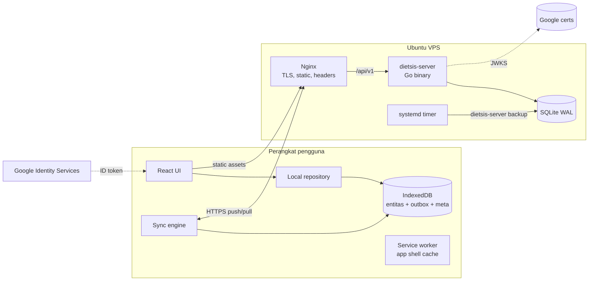
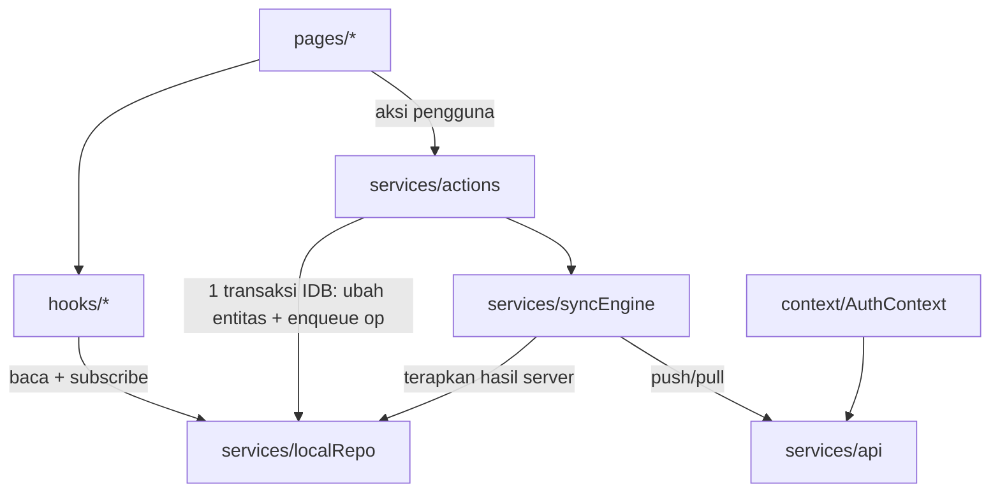
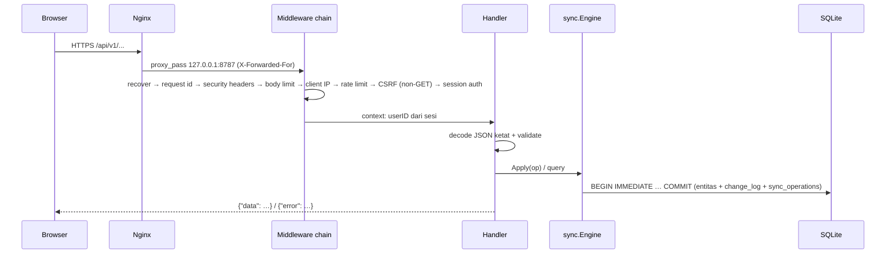

# Arsitektur

## Gambaran sistem



- **Satu origin:** `https://dietsis.transbara.my.id` melayani aset statis dan `/api/v1/*`. Tidak ada CORS; cookie sesi `SameSite=Strict`.
- **Frontend** memiliki state UI, penyimpanan lokal (IndexedDB), dan antrean operasi. UI tidak pernah menunggu jaringan.
- **Backend** adalah sumber kebenaran: autentikasi, otorisasi, validasi, aturan bisnis (kalkulasi target, konflik), persistensi, sinkronisasi.

## Struktur repository

```text
dietsis/
├── docs/                     Dokumentasi (dokumen ini, API, DB, sync, security, deploy, status)
├── public/                   Aset statis (favicon, ikon PWA)
├── src/                      Frontend React + TypeScript
│   ├── components/           Komponen UI (primitif design system + komponen fitur)
│   ├── context/              React context: Auth, Sync, Toast
│   ├── data/                 Data statis: katalog makanan bawaan, label
│   ├── hooks/                Hook data (useDay, useFoodLogs, useWeights, ...) di atas local repository
│   ├── lib/                  Logika murni & teruji: tanggal, nutrisi, validasi, CSV, id
│   ├── pages/                Halaman per route
│   ├── services/             API client, IndexedDB (local repository), outbox, sync engine
│   └── types/                Tipe domain (mencerminkan skema API)
├── server/                   Backend Go (module github.com/MonkeyDevBara/dietsis/server)
│   ├── main.go               Entrypoint & subcommand: serve, migrate, backup, restore, version
│   ├── internal/
│   │   ├── auth/             Verifikasi Google ID token (JWKS), sesi, middleware auth & CSRF
│   │   ├── backup/           Snapshot online (VACUUM INTO), verifikasi integritas, retensi, restore
│   │   ├── config/           Konfigurasi dari environment variable + validasi
│   │   ├── httpx/            Router, middleware, envelope JSON, handler REST
│   │   ├── limit/            Rate limiter token bucket (per IP / per sesi)
│   │   ├── nutrition/        Formula target & total nutrisi (vektor uji dibagi dengan frontend)
│   │   ├── store/            Koneksi SQLite, pragma, migrasi (embed), repository per entitas
│   │   ├── sync/             Mesin operasi: idempotensi, versi/konflik, change log, push/pull
│   │   └── validate/         Validasi input & batas domain
│   └── deploy/               Nginx, systemd, skrip backup/deploy (M8)
├── index.html, vite.config.ts, tsconfig*.json, eslint.config.js
├── package.json
└── README.md
```

`internal/nutrition` adalah tambahan terhadap struktur awal: formula target dan total nutrisi adalah business logic yang dipakai backend (rekomputasi target non-manual) **dan** frontend (pratinjau offline). Satu paket kecil dengan file vektor uji bersama (`server/internal/nutrition/testdata/vectors.json`) dipakai test Go dan Vitest sehingga kedua implementasi dijamin identik.

## Frontend

### Lapisan



- **Local repository** (`services/localRepo`): satu database IndexedDB per pengguna (`dietsis-<userId>`), object store per entitas + `outbox` + `meta`. Menyediakan query (per tanggal, rentang) dan event perubahan untuk hook.
- **Actions**: setiap mutasi (mis. `addFood`, `incrementWater`) menulis entitas optimistis dan operasi outbox **dalam satu transaksi IndexedDB** — tidak mungkin ada perubahan lokal tanpa operasi, atau sebaliknya.
- **Sync engine**: push outbox → pull change feed; retry dengan exponential backoff; detail di [OFFLINE_SYNC.md](OFFLINE_SYNC.md).
- **Service worker** (vite-plugin-pwa / Workbox `generateSW`): precache app shell, navigation fallback ke `index.html`; `/api/*` tidak pernah di-cache. Update ditawarkan lewat prompt, tidak diam-diam.
- **Routing**: React Router; halaman selain Beranda di-lazy-load.
- **Tipe**: field JSON memakai `snake_case` persis seperti API, sehingga tidak ada lapisan mapping.

### Routes

| Path | Halaman | Auth |
|---|---|---|
| `/login` | Login dengan Google | publik |
| `/onboarding` | Profil awal + rekomendasi target | login |
| `/` | Dashboard | login + profil |
| `/diary` | Food diary per tanggal | login + profil |
| `/progress` | Berat, lingkar pinggang, grafik, riwayat air | login + profil |
| `/profile` | Profil & target | login + profil |
| `/settings` | Akun, sinkronisasi, export, logout, hapus data | login |

## Backend

### Alur request



- Router: `net/http.ServeMux` (pola method + wildcard Go 1.22+), tanpa dependency router.
- **Satu jalur tulis:** handler REST dan `/sync/push` sama-sama membentuk `sync.Op` lalu memanggil `sync.Engine.Apply`. Aturan idempotensi, versi, konflik, dan change log hanya ada di satu tempat.
- **Identitas** selalu dari sesi (`auth.UserID(ctx)`); tidak ada field `user_id` yang diterima dari body/query.
- **SQLite**: satu `*sql.DB` dengan pool koneksi baca, penulisan diserialisasi (`BEGIN IMMEDIATE`, `busy_timeout`). Driver `modernc.org/sqlite` (pure Go, tanpa CGO) — lihat [DECISIONS.md](DECISIONS.md).

### Subcommand binary

| Perintah | Fungsi |
|---|---|
| `dietsis-server serve` (default) | Menjalankan API; menerapkan migrasi saat start |
| `dietsis-server migrate` | Menerapkan migrasi lalu keluar |
| `dietsis-server backup` | Snapshot konsisten + cek integritas + retensi (dipanggil systemd timer) |
| `dietsis-server restore <file>` | Verifikasi lalu ganti database secara atomik (service harus berhenti) |
| `dietsis-server version` | Cetak versi build |

## Konfigurasi

Backend dibaca dari environment (`server/internal/config`):

| Variabel | Default (dev) | Keterangan |
|---|---|---|
| `DIETSIS_ENV` | `development` | `production` mewajibkan HTTPS origin, client ID, path absolut; cookie selalu `Secure` |
| `DIETSIS_ADDR` | `127.0.0.1:8787` | Alamat listen (hanya loopback; Nginx di depan). Bukan 8080 agar tidak bentrok dengan layanan umum di mesin dev/VPS |
| `DIETSIS_DB_PATH` | `./data/dietsis.db` | File SQLite |
| `DIETSIS_GOOGLE_CLIENT_ID` | — | OAuth Web client ID (wajib di produksi) |
| `DIETSIS_PUBLIC_ORIGIN` | `http://localhost:5178` | Origin browser yang diizinkan (cek CSRF). Port dev tetap (bukan 5173 bawaan Vite) agar tidak bentrok dengan proyek Vite lain |
| `DIETSIS_COOKIE_SECURE` | `false` | Hanya berlaku di development |
| `DIETSIS_SESSION_TTL` | `720h` | Masa berlaku sesi (sliding), 1h–2160h |
| `DIETSIS_TRUSTED_PROXIES` | `127.0.0.1/32,::1/128` | Sumber `X-Forwarded-For` yang dipercaya |
| `DIETSIS_BACKUP_DIR` | `./data/backups` | Direktori backup |
| `DIETSIS_BACKUP_KEEP` | `14` | Jumlah backup harian yang disimpan |

Frontend (build time, `VITE_*`):

| Variabel | Keterangan |
|---|---|
| `VITE_GOOGLE_CLIENT_ID` | Client ID yang sama dengan backend (publik, bukan secret) |

## Development lokal

```bash
npm install
npm run server:dev   # Go API di 127.0.0.1:8787
npm run dev          # Vite di http://localhost:5178, proxy /api → :8787
npm run check        # lint + typecheck + test frontend & backend
```

Vite mem-proxy `/api` ke backend sehingga browser melihat satu origin, persis seperti produksi di belakang Nginx.
