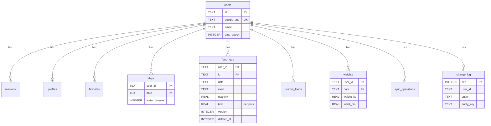

# Database

SQLite 3 (driver `modernc.org/sqlite`, pure Go) dalam mode WAL. Skema kanonik: [`server/internal/store/migrations/`](../server/internal/store/migrations/). Dokumen ini menjelaskan semantik; bila berbeda, file migrasi yang benar.

## Diagram relasi



## Konvensi

| Aturan | Alasan |
|---|---|
| Semua tabel `STRICT` | SQLite menolak tipe yang salah (mis. teks di kolom REAL) |
| `user_id` kolom pertama primary key di setiap tabel milik pengguna | Semua query terindeks per pemilik; ID milik pengguna lain tidak dapat dijangkau (anti-IDOR struktural) |
| `ON DELETE CASCADE` dari `users` | Menghapus user membersihkan semua datanya |
| Timestamp `INTEGER` epoch ms UTC, diisi server | [D-017](DECISIONS.md#d-017--timestamp--epoch-milidetik) |
| Tanggal `TEXT 'YYYY-MM-DD'` | Hari lokal pengguna; urutan leksikal = urutan kronologis |
| `version INTEGER` pada baris yang dapat diubah | Deteksi konflik ([OFFLINE_SYNC.md](OFFLINE_SYNC.md)) |
| `CHECK` hanya untuk invarian (enum, non-negatif) | Batas kebijakan ada di `internal/validate` ([D-012](DECISIONS.md#d-012--batas-validasi)); mengubahnya tidak butuh rebuild tabel |
| Boolean = `INTEGER` 0/1 dengan `CHECK` | SQLite tidak punya tipe boolean |
| `WITHOUT ROWID` untuk tabel ber-PK komposit | Data disimpan langsung di B-tree PK; lebih kecil dan cepat |

## Tabel

| Tabel | Kunci | Isi |
|---|---|---|
| `users` | `id` (UUID server), `google_sub` UNIQUE | Akun Google; `data_epoch` naik saat "hapus semua data" |
| `sessions` | `token_hash` (SHA-256) | Sesi login; `expires_at` sliding; revokasi = hapus baris |
| `profiles` | `user_id` | Data tubuh, target, flag target manual (`*_manual`), `display_name` |
| `favorites` | `(user_id, food_id)` | Set makanan favorit |
| `days` | `(user_id, date)` | Air (counter), langkah, catatan; `version` hanya untuk langkah/catatan |
| `food_logs` | `(user_id, id)` | Entri makanan; nutrisi **per porsi** (snapshot) + `quantity`; soft delete `deleted_at` |
| `custom_foods` | `(user_id, id)` | Makanan buatan pengguna (per porsi) |
| `weights` | `(user_id, date)` | Satu entri berat (+ pinggang) per tanggal |
| `sync_operations` | `(user_id, op_id)` | Ledger idempotensi: hasil setiap operasi untuk di-replay saat retry |
| `change_log` | `seq` AUTOINCREMENT; UNIQUE `(user_id, entity, entity_key)` | Feed sinkronisasi inkremental, terkompaksi |
| `schema_migrations` | `version` | Dibuat runner migrasi; versi yang sudah diterapkan |

Perbedaan terhadap daftar entitas awal (alasan di [DECISIONS.md](DECISIONS.md)):
- `users.google_sub`, `users.data_epoch` — identitas stabil & reset multi-perangkat.
- `profiles.display_name` — "Nama" di profil dapat diubah tanpa ditimpa nama Google saat login.
- `profiles.water_target_manual` — target air juga dapat diubah manual dengan aturan sama seperti kalori/protein.
- `food_logs.serving_grams`, `food_logs.deleted_at`, kolom `version` — berat per porsi, undo, konflik.

## Index

| Index | Query yang dilayani |
|---|---|
| `food_logs_user_date_idx (user_id, date) WHERE deleted_at IS NULL` | Diary per tanggal/rentang, ringkasan harian |
| `food_logs_user_recent_idx (user_id, created_at DESC) WHERE deleted_at IS NULL` | Makanan terakhir |
| `food_logs_deleted_idx (deleted_at) WHERE deleted_at IS NOT NULL` | Pembersihan soft delete > 30 hari |
| `sessions_user_idx`, `sessions_expires_idx` | Logout semua perangkat, pembersihan sesi kedaluwarsa |
| `sync_operations_created_idx` | Pembersihan ledger > 90 hari |
| `change_log_user_seq_idx (user_id, seq)` | `GET /sync/pull?since=` |
| `change_log_entity_idx` UNIQUE | Kompaksi: satu baris per entitas |

Partial index hanya dipakai bila query menyertakan `deleted_at IS NULL` — diverifikasi dengan `EXPLAIN QUERY PLAN` (lihat test di `internal/store`).

## Pola penulisan penting

**Increment air atomik** (satu statement, tanpa read-modify-write di aplikasi):

```sql
INSERT INTO days (user_id, date, water_glasses, updated_at) VALUES (?1, ?2, max(0, min(100, ?3)), ?4)
ON CONFLICT (user_id, date) DO UPDATE
SET water_glasses = max(0, min(100, water_glasses + ?3)), updated_at = ?4;
```

Parameter `?3` (delta) harus dipakai langsung di `DO UPDATE`, **bukan** `excluded.water_glasses`: nilai `excluded` sudah dijepit ≥ 0 oleh bagian INSERT sehingga pengurangan akan hilang diam-diam (ditemukan oleh test di M2).

**Kompaksi change log** (dalam transaksi yang sama dengan penulisan entitas):

```sql
DELETE FROM change_log WHERE user_id = ? AND entity = ? AND entity_key = ?;
INSERT INTO change_log (user_id, entity, entity_key, changed_at) VALUES (?, ?, ?, ?);
```

Karena setiap entitas hanya punya satu baris dengan `seq` terbaru, cursor lama mana pun tetap valid dan tabel tumbuh sebanding jumlah entitas, bukan jumlah penulisan.

**Setiap operasi** dijalankan dalam `BEGIN IMMEDIATE`: cek ledger `sync_operations` → validasi versi → tulis entitas → tulis `change_log` → simpan hasil di `sync_operations` → `COMMIT`. Retry setelah commit mengembalikan hasil tersimpan; crash sebelum commit tidak meninggalkan efek apa pun.

## Konfigurasi koneksi

Diterapkan pada setiap koneksi baru (DSN `_pragma`):

| Pragma | Nilai | Alasan |
|---|---|---|
| `journal_mode` | `WAL` | Pembaca tidak memblokir penulis |
| `synchronous` | `NORMAL` | Aman dengan WAL (tahan crash proses; transaksi terakhir bisa hilang hanya saat listrik mati) |
| `foreign_keys` | `ON` | Integritas referensial (default SQLite: OFF) |
| `busy_timeout` | `5000` | Menunggu lock alih-alih gagal langsung |
| `temp_store` | `MEMORY` | |
| `cache_size` | `-16000` | ±16 MB cache halaman |

Penulisan memakai `BEGIN IMMEDIATE` untuk menghindari deadlock upgrade read→write.

## Migrasi

- File `NNNN_nama.sql` di `server/internal/store/migrations/`, di-`embed` ke binary, diterapkan berurutan saat `serve`/`migrate`.
- Setiap migrasi berjalan dalam satu transaksi bersama insert ke `schema_migrations`; gagal = rollback penuh, server tidak start.
- Migrasi hanya maju (forward-only); perbaikan = migrasi baru. File yang sudah dirilis tidak pernah diubah (runner menyimpan checksum dan menolak bila berubah).
- Setelah migrasi: `PRAGMA foreign_key_check` harus kosong.

## Retensi & pemeliharaan (job internal server, harian)

| Data | Retensi |
|---|---|
| Sesi kedaluwarsa | Dihapus |
| `food_logs` soft-deleted | Dihapus permanen setelah 30 hari (change log tetap mencatat penghapusan) |
| `sync_operations` | 90 hari (klien tidak me-retry operasi yang lebih tua — lihat OFFLINE_SYNC) |
| `PRAGMA optimize` | Harian |

## Backup & restore

- **Backup:** `dietsis-server backup` menjalankan `VACUUM INTO '<tmp>'` (snapshot konsisten saat server tetap melayani), `PRAGMA integrity_check` pada salinan, lalu rename atomik ke `dietsis-YYYYMMDD-HHMMSS.db` dan kompres gzip; retensi `DIETSIS_BACKUP_KEEP` file terbaru. Dijadwalkan `systemd` timer harian.
- **Restore:** `dietsis-server restore <file>` saat service berhenti: dekompres ke file sementara, `integrity_check` + `foreign_key_check`, simpan database lama sebagai `*.pre-restore`, rename atomik, hapus `-wal`/`-shm` lama.
- Prosedur operasional lengkap: [DEPLOYMENT.md](DEPLOYMENT.md#backup--restore).
- Test otomatis (M7): backup → restore → data identik; backup korup ditolak.
