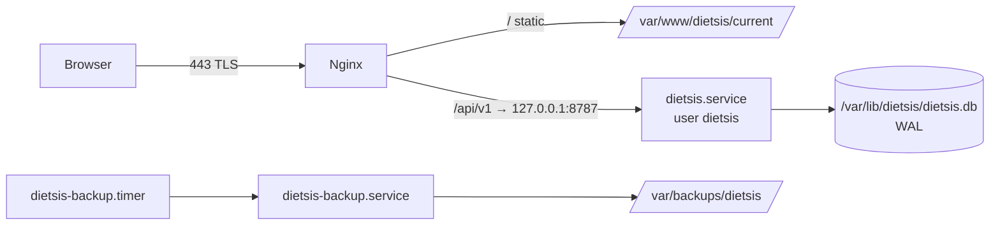

# Deployment

> **Status:** rancangan target (M0). File konfigurasi (`server/deploy/`) dan skrip dibuat di M8. **Tidak ada perubahan pada VPS produksi tanpa persetujuan eksplisit pemilik.**

## Topologi



| Item | Nilai |
|---|---|
| OS | Ubuntu Server LTS (asumsi 24.04; arsitektur dikonfirmasi saat deploy: `amd64`/`arm64`) |
| Domain | `dietsis.transbara.my.id` (DNS A/AAAA → VPS) |
| TLS | Let's Encrypt via `certbot --nginx`, perpanjangan otomatis |
| Binary | `/opt/dietsis/bin/dietsis-server` (root:root 0755) |
| Static | `/var/www/dietsis/releases/<versi>/`, symlink `current` (rollback = ganti symlink) |
| Data | `/var/lib/dietsis/` (dietsis:dietsis 0700) |
| Backup | `/var/backups/dietsis/` (dietsis:dietsis 0700) |
| Config | `/etc/dietsis/dietsis.env` (root:dietsis 0640) |
| Service user | `dietsis` (system user, tanpa shell, tanpa home) |

## Environment produksi

```bash
DIETSIS_ENV=production
DIETSIS_ADDR=127.0.0.1:8787
DIETSIS_DB_PATH=/var/lib/dietsis/dietsis.db
DIETSIS_PUBLIC_ORIGIN=https://dietsis.transbara.my.id
DIETSIS_GOOGLE_CLIENT_ID=<client-id>.apps.googleusercontent.com
DIETSIS_TRUSTED_PROXIES=127.0.0.1/32,::1/128
DIETSIS_BACKUP_DIR=/var/backups/dietsis
DIETSIS_BACKUP_KEEP=14
```

## Prasyarat Google OAuth

Google Cloud Console → APIs & Services → Credentials → OAuth client ID (Web application):
- Authorized JavaScript origins: `https://dietsis.transbara.my.id`, `http://localhost:5178`, `http://localhost`.
- Tidak perlu redirect URI (alur ID token GIS). Tidak perlu client secret.
- OAuth consent screen: nama "Dietsis", scope dasar (`openid`, `email`, `profile`).

## Build (di MacBook)

```bash
npm ci
npm run check                       # semua test & lint harus lulus
VITE_GOOGLE_CLIENT_ID=… npm run build   # → dist/
GOARCH=amd64 npm run server:build   # → dist-server/dietsis-server (linux, statis, tanpa CGO)
```

## Rencana langkah deploy (detail & skrip di M8)

1. Provision (sekali): buat user `dietsis`, direktori, `dietsis.env`; pasang Nginx + certbot; pasang unit systemd; aktifkan firewall (`ufw allow OpenSSH`, `ufw allow 'Nginx Full'`).
2. Upload binary ke `/opt/dietsis/bin/dietsis-server.new`, static ke `/var/www/dietsis/releases/<versi>/`.
3. Backup database sebelum rilis: `sudo -u dietsis dietsis-server backup`.
4. Ganti binary secara atomik (`mv`), `systemctl restart dietsis` (migrasi diterapkan saat start), cek `curl -fsS http://127.0.0.1:8787/api/v1/health`.
5. Arahkan symlink `current` ke rilis baru, `nginx -t && systemctl reload nginx`.
6. Smoke test via HTTPS: health, login, catat makanan, sinkron.
7. Rollback: symlink `current` ke rilis sebelumnya + binary sebelumnya; restore backup bila migrasi tidak kompatibel.

## Nginx (ringkasan rancangan)

- `listen 443 ssl http2`; HTTP → HTTPS redirect.
- `location /api/` → `proxy_pass http://127.0.0.1:8787`; `proxy_set_header X-Forwarded-For $remote_addr` (menimpa, bukan menambah); `client_max_body_size 1m`; `limit_req` zona per IP.
- `location /assets/` → `Cache-Control: public, max-age=31536000, immutable` (nama file ber-hash).
- `index.html`, `sw.js`, `manifest.webmanifest` → `Cache-Control: no-cache`.
- SPA fallback: `try_files $uri /index.html`.
- Header keamanan dari [SECURITY.md](SECURITY.md#header-keamanan); `gzip`/`brotli` untuk teks.

## systemd (ringkasan rancangan)

- `dietsis.service`: `Type=simple`, `User=dietsis`, `EnvironmentFile=/etc/dietsis/dietsis.env`, `ExecStart=/opt/dietsis/bin/dietsis-server serve`, `Restart=on-failure`, hardening sesuai [SECURITY.md](SECURITY.md#hardening-proses-systemd).
- `dietsis-backup.service` (`Type=oneshot`, `ExecStart=… backup`) + `dietsis-backup.timer` (`OnCalendar=*-*-* 02:30`, `Persistent=true`, `RandomizedDelaySec=10m`).

## Backup & restore

Backup otomatis harian (timer). Manual:

```bash
sudo -u dietsis /opt/dietsis/bin/dietsis-server backup
ls -l /var/backups/dietsis/
```

Restore:

```bash
sudo systemctl stop dietsis
sudo -u dietsis /opt/dietsis/bin/dietsis-server restore /var/backups/dietsis/dietsis-20261117-023000.db.gz
sudo systemctl start dietsis
curl -fsS http://127.0.0.1:8787/api/v1/health
```

Restore memverifikasi integritas sebelum mengganti database dan menyimpan database lama sebagai `dietsis.db.pre-restore`.

Off-site (disarankan): salin backup terenkripsi ke penyimpanan lain secara berkala (mis. `age` + `rsync`/`rclone`). Uji restore minimal sebulan sekali.

## Monitoring dasar

- `journalctl -u dietsis -f` — log JSON.
- Health check eksternal (mis. uptime monitor gratis) ke `https://dietsis.transbara.my.id/api/v1/health`.
- `systemctl list-timers dietsis-backup.timer` — jadwal backup.
- Ruang disk `/var/lib/dietsis` & `/var/backups/dietsis`.
