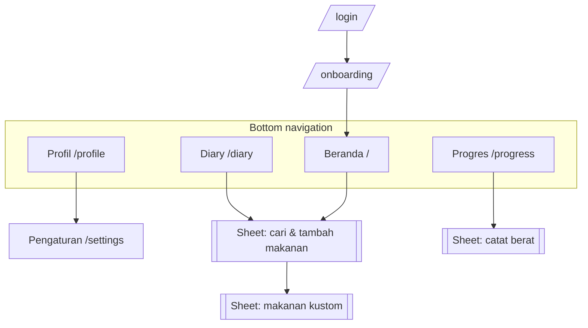

# Design System

Sumber kebenaran token: [`src/index.css`](../src/index.css). Komponen **wajib** memakai utility semantik (`bg-surface`, `text-fg-muted`, `text-protein`, …), bukan palet bawaan Tailwind (`bg-green-600`), agar tema terang/gelap tetap konsisten.

## Prinsip visual

1. **Tenang dan bersih.** Latar off-white kehijauan, kartu putih, satu warna aksen (hijau daun). Warna lain hanya untuk makna (makro, air, bahaya).
2. **Angka adalah pahlawan.** Angka utama besar, `tabular-nums`, label kecil di bawahnya.
3. **Satu tugas per layar.** Informasi sekunder di sheet atau halaman detail.
4. **Ketukan cepat.** Target sentuh minimal 44×44 px; aksi utama dalam jangkauan jempol (bagian bawah layar).
5. **Umpan balik instan.** Setiap aksi menghasilkan perubahan UI langsung + toast singkat; aksi destruktif dapat di-undo.

## Warna

Semua warna didefinisikan sebagai variabel `--ds-*` dengan varian gelap via `prefers-color-scheme`. Kontras teks utama dan `fg-muted` terhadap `surface` ≥ 4.5:1 (WCAG AA). `fg-subtle` (~3:1) hanya untuk teks non-esensial ≥ 14 px atau dekorasi.

| Token (utility) | Terang | Gelap | Pemakaian |
|---|---|---|---|
| `bg` | `#f6f8f5` | `#0f1512` | Latar halaman |
| `surface` | `#ffffff` | `#161f1a` | Kartu, sheet, nav |
| `surface-muted` | `#eef2ee` | `#1e2923` | Track progress, input, chip non-aktif |
| `border` | `#dde4de` | `#2a3730` | Garis pemisah, ring kartu |
| `fg` | `#16201b` | `#e6eee9` | Teks utama |
| `fg-muted` | `#5b6960` | `#a2b0a7` | Teks sekunder, label |
| `fg-subtle` | `#879289` | `#74817a` | Placeholder, caption |
| `primary` | `#2f7d5b` | `#5cbb8e` | Tombol utama, nav aktif, fokus |
| `primary-strong` | `#23604a` | `#7fd0a8` | Hover/pressed |
| `primary-soft` | `#e2f1e8` | `#1d3329` | Latar chip/badge aktif |
| `on-primary` | `#ffffff` | `#0b1510` | Teks di atas `primary` |
| `danger` / `danger-soft` | `#b93e2c` / `#fbe7e3` | `#ef8a78` / `#3a1f1a` | Hapus, error |
| `warning` / `warning-soft` | `#a8670c` / `#fbefd9` | `#e8b25a` / `#362a14` | Peringatan target, offline |

### Warna nutrisi (konsisten di seluruh aplikasi)

| Nutrisi | Token | Terang | Gelap |
|---|---|---|---|
| Kalori | `kcal` | `#2f7d5b` | `#5cbb8e` |
| Protein | `protein` | `#c2474d` | `#f08b8f` |
| Karbohidrat | `carbs` | `#a8670c` | `#e8b25a` |
| Lemak | `fat` | `#6f52c2` | `#ad98f0` |
| Air | `water` | `#2b73b4` | `#72b2ec` |

Setiap warna punya varian `-soft` untuk latar chip/track. Warna tidak pernah menjadi satu-satunya pembawa makna: selalu disertai label teks.

## Tipografi

System font stack (`font-sans`) — tanpa web font, nol unduhan, tampil identik dengan OS.

| Peran | Kelas | Ukuran |
|---|---|---|
| Angka hero (kalori tersisa) | `text-4xl font-semibold tabular` | 36 px |
| Judul halaman | `text-2xl font-semibold tracking-tight` | 24 px |
| Judul kartu | `text-base font-semibold` | 16 px |
| Isi | `text-base` | 16 px |
| Label/sekunder | `text-sm text-fg-muted` | 14 px |
| Caption/overline | `text-xs font-medium uppercase tracking-wide text-fg-subtle` | 12 px |

Input selalu ≥ 16 px (mencegah zoom otomatis iOS) — diterapkan global di `index.css`.

## Bentuk, jarak, elevasi

| Token | Nilai | Pemakaian |
|---|---|---|
| `rounded-control` | 14 px | Tombol, input, segmented control |
| `rounded-card` | 20 px | Kartu |
| `rounded-sheet` | 24 px | Bottom sheet (sudut atas) |
| `rounded-pill` | penuh | Chip, badge, progress bar |
| `shadow-card` | lembut 2 lapis | Kartu (+ `ring-1 ring-border`) |
| `shadow-sheet` | ke atas | Bottom sheet, toast |

Jarak memakai skala Tailwind (kelipatan 4 px). Padding horizontal halaman `px-5` (20 px) di mobile; jarak antar kartu `gap-4`. Safe area iOS: utility `pt-safe` / `pb-safe`.

## Gerak

Durasi 150–200 ms, easing `ease-standard` (`cubic-bezier(0.2, 0, 0, 1)`). Sheet naik dari bawah, toast muncul dari bawah. `prefers-reduced-motion` mematikan animasi secara global.

## Layout responsif

| Lebar | Navigasi | Konten |
|---|---|---|
| < 768 px (mobile) | Bottom navigation tetap, 4 tab | Satu kolom, `max-w-md` |
| 768–1023 px (tablet) | Bottom navigation | Satu kolom `max-w-xl`, kartu dashboard 2 kolom |
| ≥ 1024 px (desktop) | Side rail kiri | Konten `max-w-3xl`, dashboard grid 2 kolom |

## Informasi arsitektur & navigasi



- Bottom nav: **Beranda**, **Diary**, **Progres**, **Profil**. Pengaturan dibuka dari ikon roda gigi di header Profil.
- Air dicatat langsung dari kartu air di Beranda (tombol − / +); riwayat air ada di Progres.
- Tanggal aktif dipilih lewat `DateSwitcher` (‹ Hari ini ›) di Beranda dan Diary; tanggal tersimpan di query string `?date=YYYY-MM-DD` agar bisa di-refresh/dibagikan.

## Wireframe layar utama

```text
Beranda                        Diary                          Progres
┌────────────────────────────┐ ┌────────────────────────────┐ ┌────────────────────────────┐
│ Halo, Rina    ● Tersinkron │ │ ‹  Hari ini, 17 Nov  ›     │ │ Berat            72,4 kg   │
│ ‹  Hari ini, 17 Nov  ›     │ │ 1.240 / 1.800 kkal ▓▓▓░░   │ │ −1,6 kg sejak awal         │
│  ╭──────╮  Tersisa         │ │ Sarapan          420 kkal  │ │ [grafik garis 30 hari]     │
│  │ 560  │  1.240/1.800     │ │  Nasi uduk 1 porsi   420   │ │ Target 65 kg  ▓▓▓▓░ 38%    │
│  ╰──────╯  kkal            │ │  + Tambah                  │ │ [+ Catat berat]            │
│ P ▓▓▓░ 62/96 g  K ▓▓░ ...  │ │ Makan siang      820 kkal  │ │ Riwayat                    │
│ Air ●●●●●○○○  5/8  [−][+]  │ │  ...                       │ │  17 Nov  72,4 kg  80 cm    │
│ Berat 72,4 kg   −1,6 kg    │ │ Makan malam        —       │ │ Air 7 hari [batang]        │
│ Aktivitas  5.200 langkah   │ │ Camilan            —       │ │                            │
├────────────────────────────┤ ├────────────────────────────┤ ├────────────────────────────┤
│Beranda Diary Progres Profil│ │Beranda Diary Progres Profil│ │Beranda Diary Progres Profil│
└────────────────────────────┘ └────────────────────────────┘ └────────────────────────────┘
```

## Inventaris komponen (dibangun di M1, `src/components/`)

| Komponen | Spesifikasi |
|---|---|
| `Button` | Varian `primary`, `secondary`, `ghost`, `danger`; ukuran `md` (44 px) dan `sm` (36 px, hanya untuk aksi sekunder dalam baris); state `loading` menonaktifkan tombol dan menampilkan spinner |
| `IconButton` | 44×44 px, wajib `aria-label` |
| `Card` | `rounded-card bg-surface shadow-card ring-1 ring-border p-4/p-5` |
| `TextField`, `NumberField` | Label di atas, pesan error di bawah (`text-danger`, `aria-describedby`), `inputMode="decimal"` untuk angka |
| `SegmentedControl` | Pilihan 2–5 opsi (gender, kategori makan, activity level ringkas) |
| `Stepper` | − / nilai / + untuk porsi (langkah 0,5) dan air (langkah 1) |
| `ProgressRing` | Ring SVG kalori; warna `danger` bila > 105% target |
| `ProgressBar` / `MacroBar` | Track `surface-muted`, isi warna nutrisi, label nilai/target |
| `BottomSheet` | Modal dari bawah, `role="dialog"`, `aria-modal`, fokus terjebak, tutup via Esc/geser/latar |
| `Toast` | Pesan singkat 4 s; opsi aksi (mis. **Urungkan**); `role="status"` |
| `ConfirmDialog` | Untuk aksi tak dapat di-undo (hapus semua data: ketik `HAPUS`) |
| `EmptyState` | Ikon + kalimat + satu aksi |
| `Skeleton` | Placeholder saat data lokal pertama dimuat |
| `SyncBadge` | `Tersinkron` / `Menyinkronkan…` / `Offline · N tertunda` / `Perlu login ulang` |
| `DateSwitcher` | ‹ tanggal › dengan label relatif (Hari ini, Kemarin) |
| `BottomNav` / `SideRail` | Ikon + label, `aria-current="page"` pada tab aktif |
| `WeightChart` | SVG tulisan tangan (tanpa library chart) — garis berat + garis target |

Ikon: `lucide-react` (tree-shaken, hanya ikon yang dipakai).

## Pola umpan balik

| Situasi | Pola |
|---|---|
| Tambah/edit berhasil | UI langsung berubah + toast "Disimpan" |
| Hapus entri makanan | Hilang langsung + toast "Dihapus · Urungkan" (restore) |
| Validasi form | Pesan inline per field saat submit/blur; tombol simpan tetap aktif |
| Offline | `SyncBadge` kuning "Offline · N tertunda"; semua fitur tetap jalan kecuali login, export, hapus data |
| Konflik sinkronisasi | Toast "Diperbarui dari perangkat lain" + entri ditandai sebentar |
| Operasi ditolak server | Toast error yang menjelaskan apa yang dibatalkan |
| Sesi kedaluwarsa | Banner "Sesi berakhir — masuk lagi untuk sinkron"; data lokal tetap |

## Aksesibilitas

- Semua kontrol dapat dijangkau keyboard; outline fokus `primary` 2 px.
- Landmark: `header`, `nav`, `main`; satu `h1` per halaman.
- Progress ring/bar punya `role="progressbar"` + `aria-valuenow/min/max` + label teks.
- Teks dapat diperbesar hingga 200% tanpa kehilangan konten.

## Bahasa & copy

Bahasa Indonesia santai, sapaan "kamu", kalimat pendek. Angka memakai format `id-ID` (`1.240 kkal`, `72,4 kg`). Satuan: kkal, g, kg, cm, gelas (1 gelas = 250 ml).
